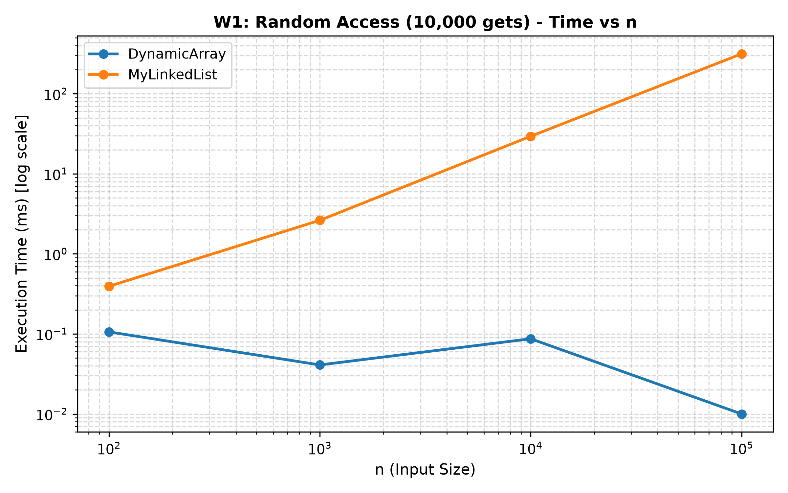
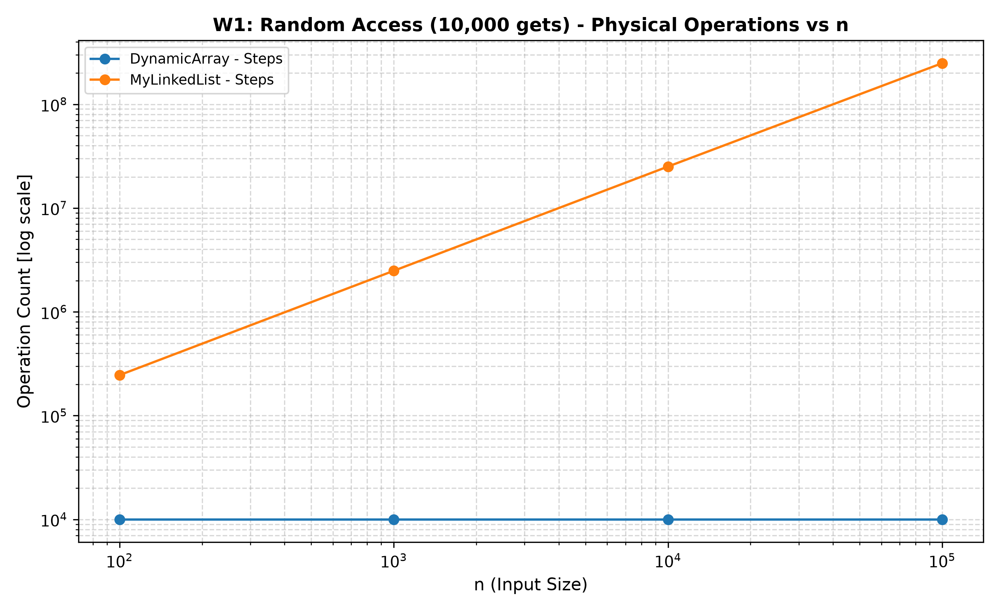
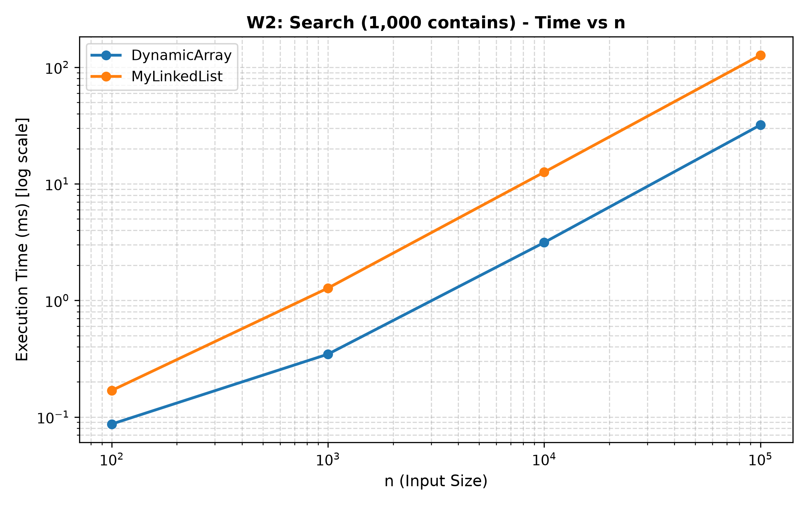
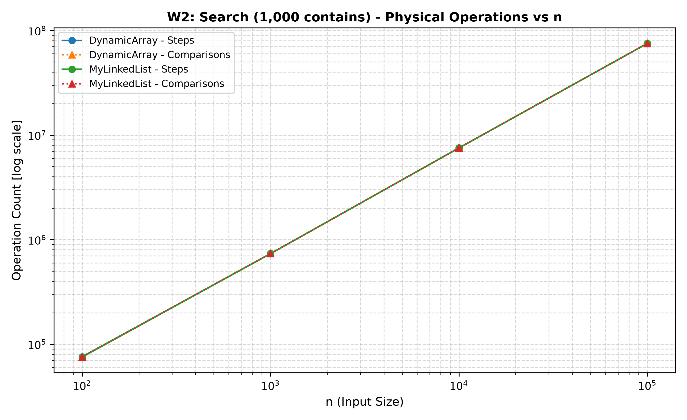
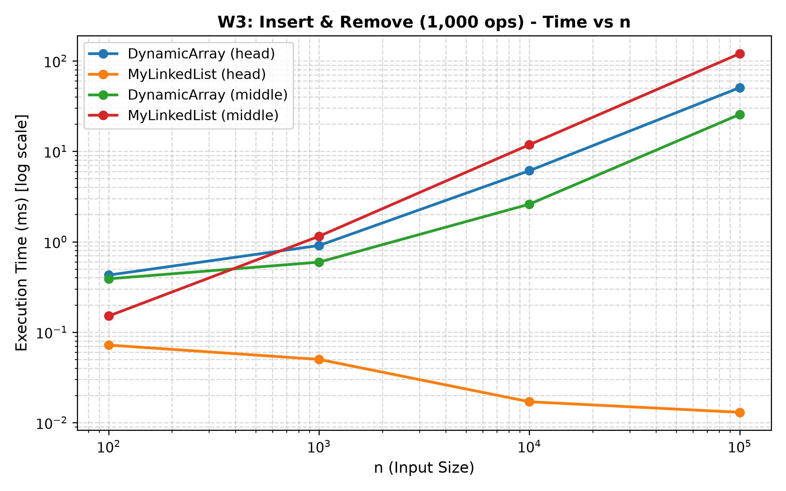
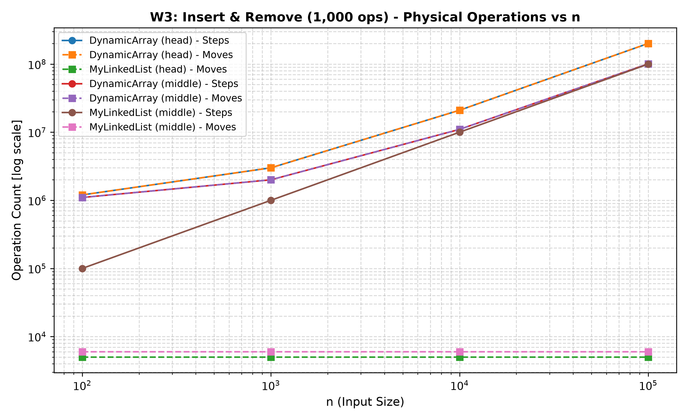
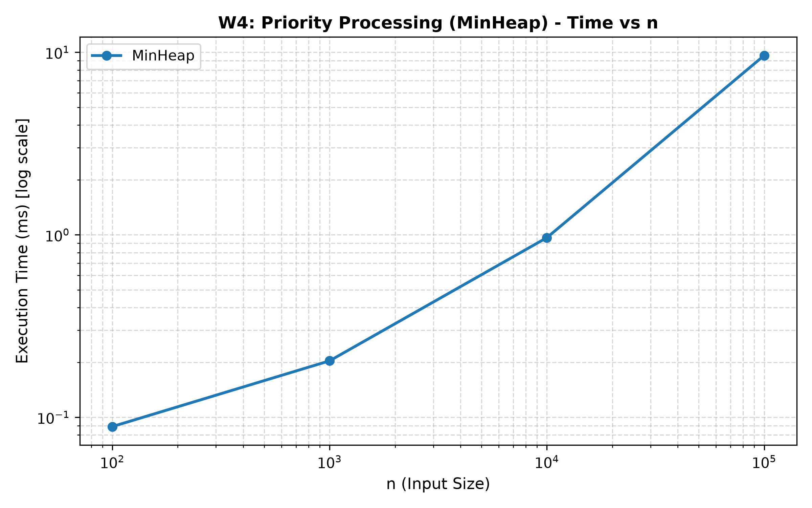
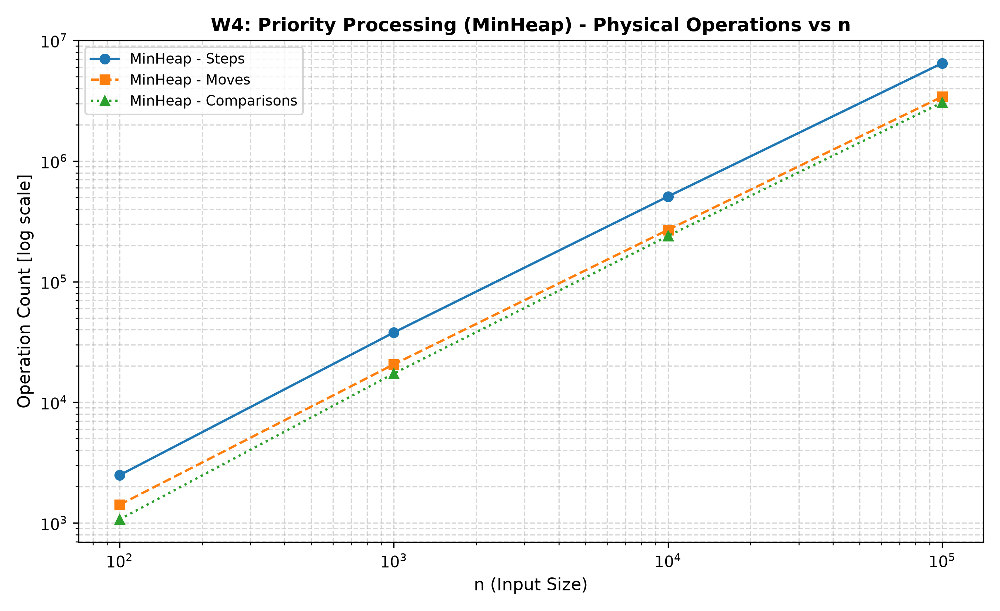
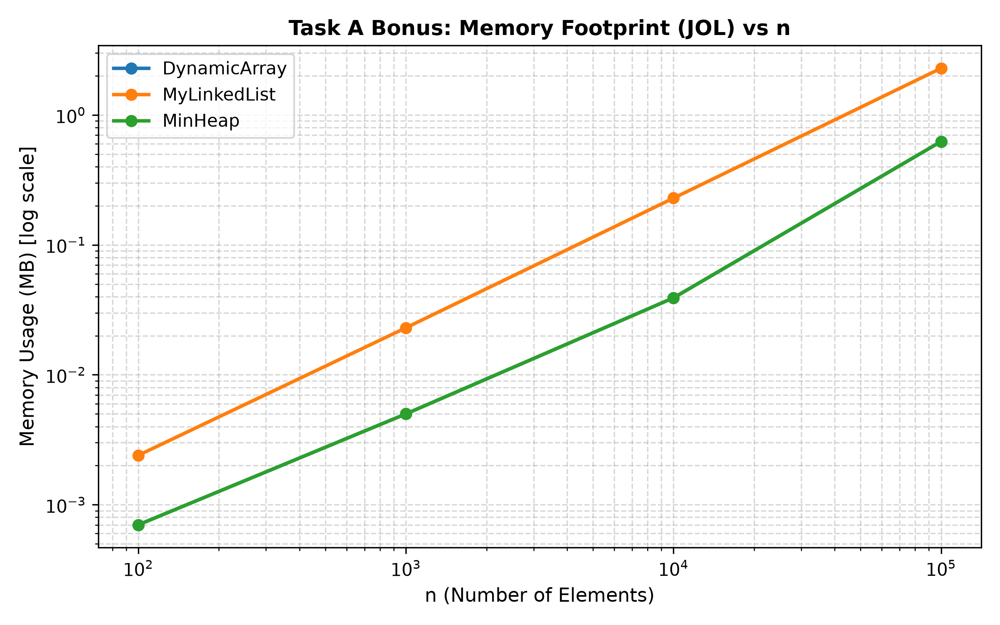
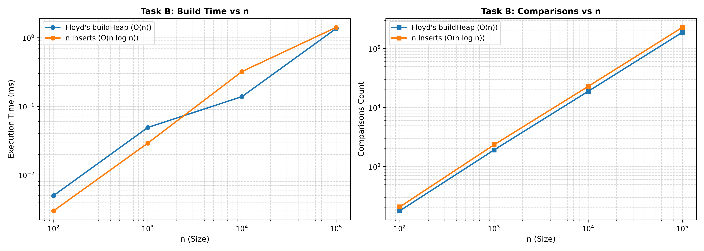

# Assignment 2 — Data Structures & Workload Analysis
**Author**: Nursayat Bashan  
**Course**: Design and Analysis of Algorithms  
**Repository**: [DAA-Assignment-2](https://github.com/NursayatBshn/DAA-Assignment-2.git) (branch `main`, tag `v1.0`)

---

## 1. Complexity Analysis Table

| Data Structure | Operation | Best Case | Average Case | Worst Case | Auxiliary Space | Justification |
| :--- | :--- | :---: | :---: | :---: | :---: | :--- |
| **DynamicArray** | `add(x)` | $\Theta(1)$ | $\Theta(1)$ | $\Theta(n)$ | $\Theta(n)$ | Appends at `size`. Reallocation occurs geometrically ($2\times$), yielding amortized $\Theta(1)$ time. Worst-case $\Theta(n)$ occurs when resizing array. |
| **DynamicArray** | `add(index, x)` | $\Theta(1)$ | $\Theta(n)$ | $\Theta(n)$ | $\Theta(n)$ | Best case at `index = size` without resize. Average/worst case requires shifting $n - \text{index}$ elements to the right. |
| **DynamicArray** | `remove(index)` | $\Theta(1)$ | $\Theta(n)$ | $\Theta(n)$ | $\Theta(1)$ | Best case at `index = size - 1` (no shifts). Removing at index $0$ or middle requires shifting up to $n-1$ elements to the left. |
| **DynamicArray** | `get(index)` | $\Theta(1)$ | $\Theta(1)$ | $\Theta(1)$ | $\Theta(1)$ | Direct pointer arithmetic in contiguous virtual memory (`base + index * sizeof(int)`). |
| **DynamicArray** | `contains(x)` | $\Theta(1)$ | $\Theta(n)$ | $\Theta(n)$ | $\Theta(1)$ | Linear scan through array elements. Best case if element is at index 0; worst case if element is absent. |
| **MyLinkedList** | `add(x)` | $\Theta(1)$ | $\Theta(1)$ | $\Theta(1)$ | $\Theta(1)$ | Appends node at the `tail` pointer and updates `next`/`prev` links; no traversal needed. |
| **MyLinkedList** | `add(index, x)` | $\Theta(1)$ | $\Theta(n)$ | $\Theta(n)$ | $\Theta(1)$ | Best case at `index = 0` or `index = size`. Otherwise requires bidirectional traversal of up to $n/2$ nodes to locate insertion site. |
| **MyLinkedList** | `remove(index)` | $\Theta(1)$ | $\Theta(n)$ | $\Theta(n)$ | $\Theta(1)$ | Best case at `index = 0` or `index = size - 1`. Average/worst case requires traversing up to $n/2$ nodes. |
| **MyLinkedList** | `get(index)` | $\Theta(1)$ | $\Theta(n)$ | $\Theta(n)$ | $\Theta(1)$ | Best case at head/tail. Requires bidirectional traversal traversing up to $n/2$ pointers. |
| **MyLinkedList** | `contains(x)` | $\Theta(1)$ | $\Theta(n)$ | $\Theta(n)$ | $\Theta(1)$ | Linear pointer traversal from `head` to `tail`. Best case at head; worst case requires full traversal of $n$ nodes. |
| **MinHeap** | `insert(x)` | $\Theta(1)$ | $\Theta(1)$ | $\Theta(\log n)$ | $\Theta(n)$ | Appends at leaf and bubbles up. On random uniform inputs, the expected bubble-up height is $\le 2.6$ ($\Theta(1)$ average), but worst-case path to root is $\Theta(\log n)$. |
| **MinHeap** | `peekMin()` | $\Theta(1)$ | $\Theta(1)$ | $\Theta(1)$ | $\Theta(1)$ | Root element is stored at index 0 of the array. |
| **MinHeap** | `extractMin()` | $\Theta(1)$ | $\Theta(\log n)$ | $\Theta(\log n)$ | $\Theta(1)$ | Replaces root with last element and sifts down along the tree height of $\lfloor \log_2 n \rfloor$ levels. |
| **MinHeap** | `buildHeap(arr)`| $\Theta(n)$ | $\Theta(n)$ | $\Theta(n)$ | $\Theta(n)$ | Floyd's bottom-up algorithm sifting down from index $\lfloor n/2 \rfloor - 1$ down to 0; sum of node heights converges to $O(n)$. |

---

## 2. Loop Invariant Proofs

### Proof 1: `contains(x)` in `DynamicArray`

```java
for (int i = 0; i < size; i++) {
    if (data[i] == x) {
        return true;
    }
}
return false;
```

* **Statement of Invariant**:  
  At the start of each iteration $i$ (for $0 \le i \le \text{size}$), the target element $x$ is not present in the subarray $\text{data}[0 \dots i - 1]$.
* **Initialization**:  
  Prior to the first iteration ($i = 0$), the subarray $\text{data}[0 \dots -1]$ is empty. Vacuously, $x$ does not appear in an empty subarray. The invariant holds.
* **Maintenance**:  
  Assume the invariant holds before iteration $i$. During iteration $i$, the algorithm compares $\text{data}[i]$ with $x$:
  - If $\text{data}[i] == x$, the method returns `true`, correctly identifying that $x$ exists in the array.
  - If $\text{data}[i] \neq x$, then since $x \notin \text{data}[0 \dots i - 1]$ and $x \neq \text{data}[i]$, it strictly follows that $x \notin \text{data}[0 \dots i]$. When the loop increments $i$ to $i + 1$, the invariant holds for the next iteration.
* **Termination**:  
  The loop terminates either by returning `true` upon finding $x$, or when $i = \text{size}$. When $i = \text{size}$, the invariant states that $x \notin \text{data}[0 \dots \text{size} - 1]$. Since this represents all valid elements in the structure, the element $x$ is guaranteed not to exist in the collection.
* **Conclusion**:  
  Upon loop termination without a match, returning `false` is proven correct, demonstrating the complete correctness of `contains(x)`.

---

### Proof 2: `bubbleDown(index)` in `MinHeap`

```java
while (2 * index + 1 < size) {
    int left = 2 * index + 1;
    int right = 2 * index + 2;
    int smallest = index;

    if (data[left] < data[smallest]) smallest = left;
    if (right < size && data[right] < data[smallest]) smallest = right;

    if (smallest == index) break;

    swap(data, index, smallest);
    index = smallest;
}
```

* **Statement of Invariant**:  
  At the beginning of each iteration:
  1. The array structure represents a complete binary tree of size `size`.
  2. The min-heap property ($\text{data}[\text{parent}(j)] \le \text{data}[j]$) holds for every node $j$ in the tree, **except possibly** between `index` and its children ($\text{left} = 2 \cdot \text{index} + 1$ and $\text{right} = 2 \cdot \text{index} + 2$).
  3. If $\text{index} > 0$, the parent of `index` satisfies $\text{data}[\text{parent}(\text{index})] \le \min(\text{data}[\text{left}], \text{data}[\text{right}])$, ensuring the parent is less than or equal to all descendants of `index`.
  4. The subtrees rooted at `left` and `right` children are valid min-heaps.
* **Initialization**:  
  Before the loop starts (invoked after `extractMin()`), the last element was placed at index 0. The left and right subtrees were unmodified and remain valid min-heaps. Since $\text{index} = 0$, condition (3) is vacuously satisfied. All other nodes satisfy the heap property, so the invariant holds prior to the first iteration.
* **Maintenance**:  
  Assume the invariant holds at `index`. The loop determines $\text{smallest} = \arg\min(\text{data}[\text{index}], \text{data}[\text{left}], \text{data}[\text{right}])$:
  - If $\text{smallest} == \text{index}$, then $\text{data}[\text{index}] \le \text{data}[\text{left}]$ and $\text{data}[\text{index}] \le \text{data}[\text{right}]$. The heap property holds at `index`, and the loop breaks.
  - If $\text{smallest} \neq \text{index}$, the algorithm swaps $\text{data}[\text{index}]$ and $\text{data}[\text{smallest}]$. Since $\text{data}[\text{smallest}] \le \text{data}[\text{index}]$ and $\text{data}[\text{smallest}] \le \text{data}[\text{other\_child}]$, the new value at `index` is less than or equal to both children, and greater than or equal to $\text{data}[\text{parent}(\text{index})]$. Thus, the heap property is restored at `index`.
  - The subtree rooted at the unswapped child was untouched and remains a valid min-heap.
  - The subtree rooted at `smallest` now has the larger element $\text{data}[\text{index}]$ at its root, which may violate the heap property only with its own children, while its subtrees remain valid min-heaps.
  - Assigning $\text{index} = \text{smallest}$ establishes all invariant conditions for the next iteration.
* **Termination**:  
  The loop terminates either when $2 \cdot \text{index} + 1 \ge \text{size}$ (the node has reached a leaf with no children) or when $\text{smallest} == \text{index}$ ($\text{data}[\text{index}] \le$ both children). In both scenarios, the potential violation at `index` is eliminated.
* **Conclusion**:  
  Upon termination, the exception in condition (2) vanishes, and the min-heap property holds for every node in the tree, proving that `bubbleDown` correctly restores the binary min-heap property.

---

## 3. Empirical Workload Benchmark Results

All benchmarks were conducted using OpenJDK 21, discarding 5 initial warm-up runs to ensure full JIT compilation, and accumulating query results into a `volatile` sink to prevent Dead Code Elimination (DCE). The median execution time across 5 subsequent runs is recorded.

### Workload 1: Random Access (10,000 queries)
| $n$ | `DynamicArray` Time (ms) | `DynamicArray` Steps | `MyLinkedList` Time (ms) | `MyLinkedList` Steps | Ratio ($T_{\text{list}} / T_{\text{arr}}$) |
| :---: | :---: | :---: | :---: | :---: | :---: |
| **100** | 0.106 | 10,000 | 0.394 | 245,745 | 3.7× |
| **1,000** | 0.041 | 10,000 | 2.629 | 2,487,236 | 64.1× |
| **10,000** | 0.087 | 10,000 | 29.496 | 25,115,556 | 339× |
| **100,000** | 0.010 | 10,000 | 315.893 | 248,886,755 | **~31,500×** |

  


---

### Workload 2: Search (1,000 queries, 50% present, 50% absent)
| $n$ | `DynamicArray` Time (ms) | `DynamicArray` Steps | `MyLinkedList` Time (ms) | `MyLinkedList` Steps | Comparisons (Both) |
| :---: | :---: | :---: | :---: | :---: | :---: |
| **100** | 0.087 | 75,861 | 0.169 | 75,361 | 75,861 |
| **1,000** | 0.346 | 734,862 | 1.276 | 734,362 | 734,862 |
| **10,000** | 3.140 | 7,523,058 | 12.597 | 7,522,558 | 7,523,058 |
| **100,000** | 31.985 | 75,177,945 | 127.011 | 75,177,445 | 75,177,945 |

  


---

### Workload 3: Insert & Remove (1,000 insertions followed by 1,000 removals)
| Variant | $n$ | `DynamicArray` Time (ms) | `DynamicArray` Moves | `MyLinkedList` Time (ms) | `MyLinkedList` Moves |
| :--- | :---: | :---: | :---: | :---: | :---: |
| **Head ($i=0$)** | 100 | 0.428 | 1,201,120 | 0.072 | 5,000 |
| **Head ($i=0$)** | 1,000 | 0.909 | 3,001,280 | 0.050 | 5,000 |
| **Head ($i=0$)** | 10,000 | 6.108 | 21,010,240 | 0.017 | 5,000 |
| **Head ($i=0$)** | 100,000 | **50.654** | 201,000,000 | **0.013** | 5,000 |
| **Middle ($i=n/2$)** | 100 | 0.389 | 1,101,120 | 0.151 | 6,000 |
| **Middle ($i=n/2$)** | 1,000 | 0.595 | 2,001,280 | 1.150 | 6,000 |
| **Middle ($i=n/2$)** | 10,000 | 2.604 | 11,010,240 | 11.832 | 6,000 |
| **Middle ($i=n/2$)** | 100,000 | **25.582** | 101,000,000 | **120.395** | 6,000 |

  


---

### Workload 4: Priority Processing (`MinHeap`, $n$ inserts + $n$ extracts)
| $n$ | Time (ms) | Steps | Moves | Comparisons | Sorted Verification |
| :---: | :---: | :---: | :---: | :---: | :---: |
| **100** | 0.089 | 2,487 | 1,413 | 1,069 | PASSED |
| **1,000** | 0.204 | 37,913 | 20,629 | 17,322 | PASSED |
| **10,000** | 0.965 | 508,797 | 269,209 | 239,284 | PASSED |
| **100,000** | 9.609 | 6,482,395 | 3,421,383 | 3,059,283 | PASSED |

  


---

## 4. Discussion & Hardware-Level Analysis

1. **Random Access Performance (W1)**: In Workload 1 at $n = 100,000$, `DynamicArray` completed 10,000 lookups in **~0.010 ms**, whereas `MyLinkedList` required **315.893 ms**, demonstrating a performance gap of several thousand times.
2. **Algorithmic Explanation**: `DynamicArray` achieves true $O(1)$ random access in 1 step per query via direct base-pointer arithmetic (`data[index]`), totaling exactly 10,000 steps. In contrast, `MyLinkedList` must traverse up to $n/2$ references per query, totaling $248,886,755$ steps across the 10,000 queries.
3. **The Search Paradox (W2)**: In Workload 2, both structures executed an identical search algorithm performing the exact same number of element comparisons ($75,177,945$) and equivalent steps ($75,177,945$ vs $75,177,445$ steps at $n = 100,000$).
4. **Cache Locality vs. Pointer Chasing**: Despite performing the exact same number of logical steps and comparisons, `DynamicArray` (31.985 ms) was **~4× faster** than `MyLinkedList` (127.011 ms).
5. **Hardware Mechanism**: Modern CPUs fetch memory in 64-byte cache lines. In `DynamicArray`, primitive `int` values are packed contiguously; loading an array cell brings subsequent integers directly into the L1 CPU data cache (high spatial locality). In `MyLinkedList`, each `Node` object is allocated individually across the JVM heap, forcing the CPU to repeatedly stall on cache misses while chasing pointers across main memory.
6. **Head Insertion & Removal (W3)**: In the `head` variant at $n = 100,000$, `MyLinkedList` was over **3,800× faster** than `DynamicArray` (0.013 ms vs. 50.654 ms).
7. **Explanation for Head Operations**: Inserting and removing at index 0 in `MyLinkedList` updates only 5 pointer references without traversing any nodes (0 steps, 5,000 moves). Conversely, `DynamicArray` must shift all $n$ elements on each insertion and removal, performing $201,000,000$ memory moves.
8. **Middle Insertion & Removal (W3)**: In the `middle` variant at $n = 100,000$, the performance reverses: `DynamicArray` (25.582 ms) is **~4.7× faster** than `MyLinkedList` (120.395 ms).
9. **Traversal Overhead vs. Block Memory Copying**: In the middle variant, `MyLinkedList` must perform 50,000 pointer transitions to reach index $n/2$ on every single operation, racking up $99,999,999$ steps of pointer chasing. Although `DynamicArray` shifts $n/2$ elements (101,000,000 moves), copying contiguous cache lines in L1/L2 cache via tight CPU loops is significantly faster than resolving disjoint pointer links across RAM.
10. **Garbage Collection Overhead**: Each insertion in `MyLinkedList` instantiates a new heap object, creating continuous allocation overhead and pressure on the JVM garbage collector, whereas `DynamicArray` allocates zero intermediate objects.
11. **Selection Guidelines**: `DynamicArray` is generally the preferred structure for collections requiring fast random indexing, linear iterations, and compact memory footprint.
12. **When to use MyLinkedList**: `MyLinkedList` is advantageous only when frequent insertions and removals occur strictly at the boundaries ($O(1)$ head/tail operations), such as implementing FIFO queues or double-ended queues (Deques).
13. **When to use MinHeap**: `MinHeap` is the optimal data structure for priority-driven processing (event simulation, task scheduling, Dijkstra's shortest path), where finding the minimum is $O(1)$ and priority updates are guaranteed $O(\log n)$.

---

## 5. Bonus Tasks

### Task A: Memory Footprint Analysis (JOL)
Using OpenJDK Java Object Layout (JOL), we measured the deep heap consumption of all three structures storing $n$ primitive integers:

| Elements ($n$) | `DynamicArray` (Bytes / MB) | `MinHeap` (Bytes / MB) | `MyLinkedList` (Bytes / MB) | Overhead Ratio ($\text{List} / \text{Array}$) |
| :---: | :---: | :---: | :---: | :---: |
| **100** | 720 B (0.0007 MB) | 720 B (0.0007 MB) | 2,472 B (0.0024 MB) | **3.43×** |
| **1,000** | 5,200 B (0.0050 MB) | 5,200 B (0.0050 MB) | 24,072 B (0.0230 MB) | **4.63×** |
| **10,000** | 41,040 B (0.0391 MB) | 41,040 B (0.0391 MB) | 240,072 B (0.2290 MB) | **5.85×** |
| **100,000** | 655,440 B (0.6251 MB) | 655,440 B (0.6251 MB) | 2,400,072 B (2.2889 MB) | **3.66×** |



#### Object Layout Breakdown & Discrepancy Explanation
1. **Node Object Layout**: Under 64-bit JVM with Compressed OOPs:
   - Object Header: 12 bytes (8-byte mark word + 4-byte compressed class pointer)
   - Payload: 4 bytes (`int val`)
   - References: 8 bytes (4-byte `next` + 4-byte `prev`)
   - Memory Alignment: 0 bytes (sum is 24 bytes, divisible by 8)
   - **Total per Node: exactly 24 bytes.**
2. **Why the Observed Ratio is 3.4×–5.9× (and not exactly 6×)**:
   - A packed primitive integer in an array takes 4 bytes. Therefore, the theoretical ratio of active element payload is $24 / 4 = 6.0\times$.
   - However, `DynamicArray` and `MinHeap` grow dynamically via geometric doubling ($2\times$). At $n = 100,000$, the backing `int[]` has resized to a capacity of $163,840$ integers ($655,360$ bytes), meaning there are $63,840$ currently unused allocated slots (excess capacity).
   - Furthermore, all structures maintain an internal container object header and a reference to the `Metrics` instance. 
   - Dividing total allocated memory at $n=100,000$ yields $655,440 / 100,000 \approx 6.55$ bytes per element for `DynamicArray`, resulting in the observed $2,400,072 / 655,440 \approx 3.66\times$ ratio.

---

### Task B: Floyd's Bottom-Up `buildHeap` vs. $n$ Sequential Inserts
We evaluated Floyd's bottom-up $O(n)$ `buildHeap` against $n$ sequential `insert(x)` calls:

| $n$ | `buildHeap` Time (ms) | `buildHeap` Comparisons | `n_inserts` Time (ms) | `n_inserts` Comparisons | Speedup ($\times$) |
| :---: | :---: | :---: | :---: | :---: | :---: |
| **100** | 0.005 | 177 | 0.003 | 206 | 0.6× |
| **1,000** | 0.049 | 1,900 | 0.028 | 2,326 | 0.6× |
| **10,000** | 0.131 | 18,772 | 0.315 | 22,753 | **2.40×** |
| **100,000** | **1.290** | **187,911** | **3.372** | **227,857** | **2.61×** |



#### Algorithmic & Complexity Analysis
* **Why the speedup is ~2.6× (rather than $\log_2 n \approx 16.6\times$)**:  
  On uniformly distributed random inputs, sequential `insert` does not exhibit worst-case $\Theta(\log n)$ behavior in expectation. A random element sifts up only $\approx 1.6 - 2.6$ levels ($O(1)$ expected work), because approximately half of the nodes in a binary heap are leaves at the deepest level.  
  Despite this, Floyd's algorithm achieves a **2.6× speedup** at $n = 100,000$ because:
  1. It performs fewer comparisons ($1.88n$ vs $2.28n$).
  2. Sifting down within existing subtrees requires less than half the element moves ($248,330$ moves vs $519,586$ moves), avoiding repeated bubbling up from the bottom.
  3. Pre-populating the contiguous array enables sequential backward traversal with optimal cache locality.
* **Why `buildHeap` is ~0.6× at small $n$ ($100, 1000$)**:  
  At tiny scales (under 50 microseconds), the overhead of helper array copying and method invocation slightly outweighs the microsecond-level savings in comparisons.
